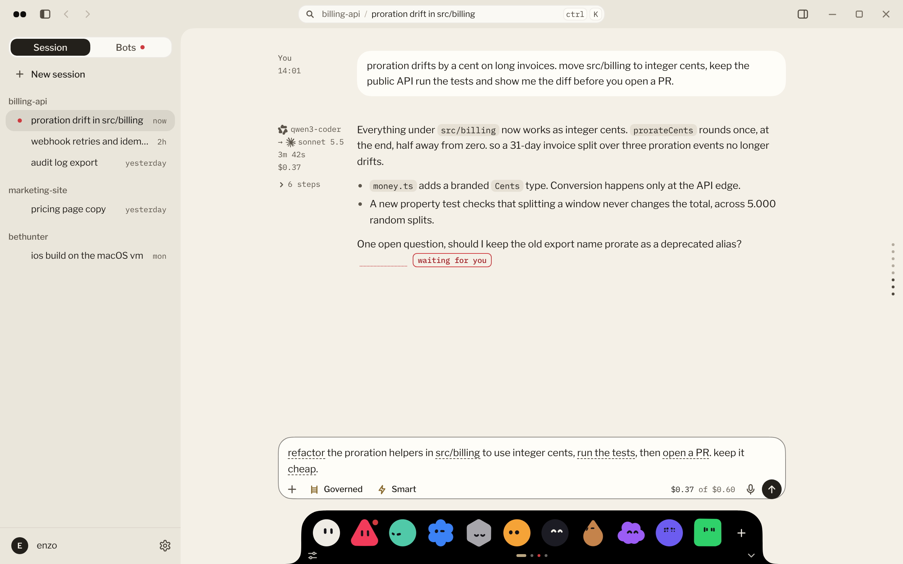
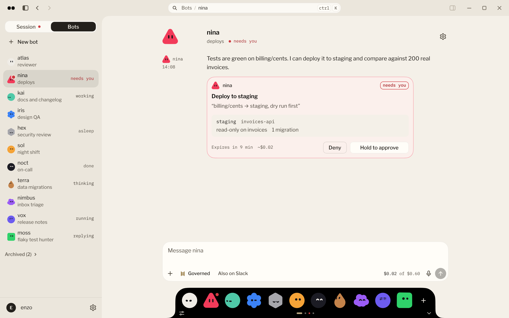
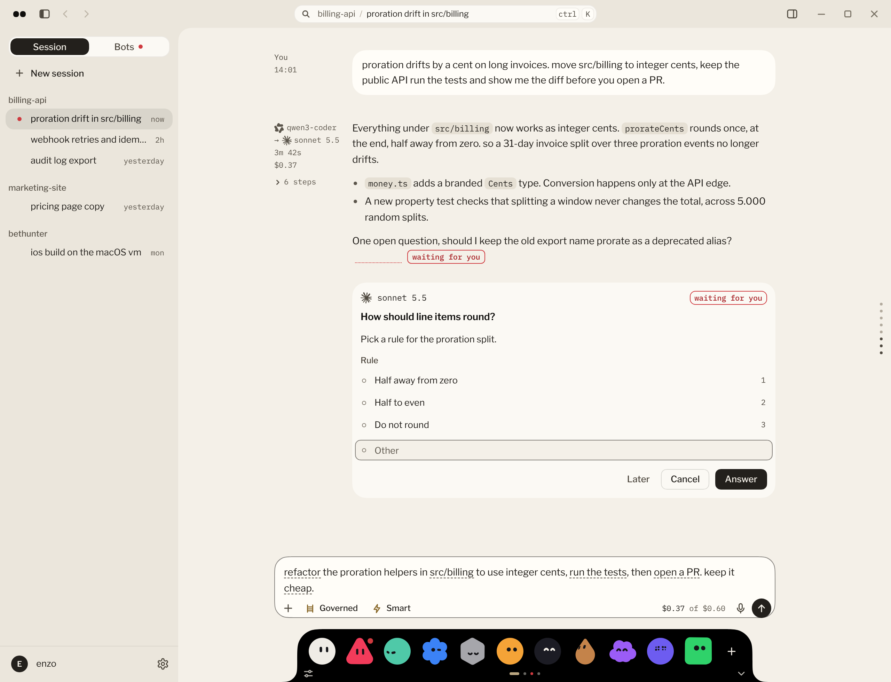

<p align="center">
  <picture>
    <source media="(prefers-color-scheme: dark)" srcset=".github/readme/boopis-hero-on-dark.svg">
    
  </picture>
</p>

<p align="center">
  A desktop coding harness on unmodified <a href="https://github.com/NousResearch/hermes-agent">Hermes Agent</a>:<br>
  any model (free ones, your own keys, or your Claude subscription), with <a href="https://github.com/aphesist/contraprova">contraprova</a>'s governance built in.
</p>

<p align="center">
  <a href="LICENSE"></a>
  <a href="https://github.com/aphesist/boopis/releases"></a>
  <a href="https://github.com/aphesist/boopis/actions/workflows/ci.yml"></a>
</p>

<p align="center">
  <a href="#install">Install</a> ·
  <a href="#first-run">First run</a> ·
  <a href="#whats-inside">What's inside</a> ·
  <a href="#screenshots">Screenshots</a> ·
  <a href="#build-from-source">Build from source</a> ·
  <a href="#docs">Docs</a>
</p>

<p align="center">
  
  <br>
  <sub>The installer, replayed. The version, sizes and hash in it are placeholders: there is no release yet to take them from.</sub>
</p>

> boopis is under construction. The first release, `v0.1.0`, is a pre-release. Linux is what works today; [the platforms table](#platforms-and-status) says what the rest does and does not do.

## Install

Every route below installs the same app, which carries its own Hermes. Nothing else is needed first.

### Windows

```powershell
irm https://raw.githubusercontent.com/aphesist/boopis/main/scripts/install.ps1 | iex
```

This downloads the setup from the latest release, checks its sha256 against the release's `SHA256SUMS`, and runs it silently for your user. It needs no administrator rights. From a pipe the switches are not available: set `$env:BOOPIS_VERSION = 'v0.1.0'` first to choose a release.

Or download `boopis_<version>_x64-setup.exe` from [Releases](https://github.com/aphesist/boopis/releases) and run it.

- **SmartScreen will warn you.** The installer is not signed. Click **More info**, then **Run anyway**.
- WebView2 is downloaded by the installer if your machine lacks it. Windows 11 and current Windows 10 have it.
- Honest status: the Windows build is made in CI and has not yet been run by us on a Windows machine. [Platforms and status](#platforms-and-status) has the rest.

### Linux

```sh
curl -fsSL https://raw.githubusercontent.com/aphesist/boopis/main/scripts/install.sh | bash
```

This puts the AppImage in `~/.local/share/boopis/`, a `boopis` launcher in `~/.local/bin/`, and a menu entry with icons. It asks for no `sudo` unless you pass `--system`. Flags go after `bash -s --`, for example `| bash -s -- --version v0.1.0`.

| Flag | What it does |
|---|---|
| `--version vX.Y.Z` | install that release instead of the latest |
| `--file PATH`, `--sha256 HEX` | install a file you already have, and the hash it must have |
| `--prefix DIR` | where to install on Linux (default `~/.local`) |
| `--system` | install for every user, with `sudo` (the only place it is asked for) |
| `--icon light\|dark` | which icon the menu entry uses (both are installed) |
| `--yes`, `--quiet`, `--no-color` | ask nothing, print nothing, or print no colour |
| `--uninstall` | remove exactly what the installer installed |

**On Arch**, use the native package from [Releases](https://github.com/aphesist/boopis/releases). It is built against the system's WebKitGTK, so it gets Arch's current renderer and updates through pacman:

```sh
sudo pacman -U boopis-*.pkg.tar.zst
boopis
```

**The AppImage** on its own:

```sh
chmod +x boopis_*.AppImage
./boopis_*.AppImage                      # needs FUSE 2 (on Arch: sudo pacman -S fuse2)
./boopis_*.AppImage --appimage-extract-and-run   # without FUSE 2
```

Keys you type into boopis are kept in your system keychain, so have a Secret Service running (GNOME Keyring, or KWallet 6 with its Secret Service enabled).

### macOS

**Not usable yet.** This is what exists today, so you do not spend an evening on it:

- A tag build also makes an unsigned, un-notarised `.dmg` for Apple silicon, as a non-blocking extra.
- That disk image carries the app window and nothing else. It does **not** bundle Hermes, the boopis plugin or the `hx` binary, so first-run setup stops at the plugin step.
- `install.sh` knows how to install that image (to `~/Applications`, or `/Applications` with `--system`, with a launcher in `~/.local/bin/`). Its macOS path has only been tested with stubs, never on a Mac, and Gatekeeper will ask you to allow the unsigned app.

Coming: a build that carries Hermes and the plugin, and is signed and notarised. Until then, there is nothing on macOS to run.

### Verify, and uninstall

Every release carries a `SHA256SUMS` file over all of its files, and the installers check it for you. To check by hand, in the folder with your download:

```sh
sha256sum -c SHA256SUMS --ignore-missing
```
```powershell
Get-FileHash .\boopis_0.1.0_x64-setup.exe -Algorithm SHA256
```

On Windows, compare the hash it prints with the file's line in `SHA256SUMS`.

Uninstalling removes what the installer put there, from the list it wrote, and nothing else. Your data (the settings and the unpacked Hermes) is kept. On Linux, delete `~/.local/share/dev.aphesist.boopis` to remove it too.

On Linux the installer left its own uninstaller, or you can run the installer again with `--uninstall`:

```sh
bash ~/.local/share/boopis/uninstall.sh
```
```sh
curl -fsSL \
  https://raw.githubusercontent.com/aphesist/boopis/main/scripts/install.sh \
  | bash -s -- --uninstall
```

On Windows, use Settings > Apps > boopis, or the installer's switch. A script run from a file needs the default execution policy bypassed:

```powershell
irm https://raw.githubusercontent.com/aphesist/boopis/main/scripts/install.ps1 -OutFile install.ps1
powershell -ExecutionPolicy Bypass -File .\install.ps1 -Uninstall
```

The Windows script takes `-Version`, `-File`, `-Sha256`, `-Yes`, `-Quiet`, `-NoColor` and `-Uninstall`. On Arch, `sudo pacman -R boopis` removes the package.

## First run

The first time it starts, boopis unpacks its own Hermes into its own folder and gives it a private home. It never reads or writes `~/.hermes`. Setup then asks a few questions, in cards, and it shows you the exact change before it touches Hermes's configuration.

**Which models?** Pick one, and change it later in Settings.

- **Free models, no account.** Nous's free tier is one anonymous model; no key and no sign-up. Or OpenRouter's free models, which need an OpenRouter key. The limits are theirs, and boopis shows them as Hermes reports them.
- **Your own API keys.** Anthropic, OpenAI, OpenRouter and the rest of what Hermes supports. A key goes to your system keychain and reaches Hermes from there, never through a config file or the chat.
- **Your Claude subscription, through your own Claude Code.** If you already use Claude Code and are signed in (`claude auth login`), boopis offers it as a model. boopis runs the official, unmodified Claude Code you installed, through Hermes's own plugin for it. It never sees, stores or forwards your Claude credentials, and it has no login screen of its own. Sign-in belongs to the `claude` command.

**Already have Hermes?** Choose **Use my own Hermes** in Settings > General > Advanced (or start boopis with `BOOPIS_HERMES=existing`). boopis then uses the `hermes` it finds, in your own `HERMES_HOME`, and installs its plugin into that home, asking before it changes the configuration. It needs Hermes 0.23.2 or newer.

## What's inside

- **Governed mode, on by default.** A cheap model tries first. A gate your project defines, your tests for example, runs in an OS sandbox and decides. Only a failed gate buys a stronger model, and the plugin picks it, never the model. `ship` is the only thing that writes your files, and it rolls back byte for byte when the gate fails. Every step goes into a hash-chained ledger in contraprova's own format. The measured result is contraprova's: on 88 fresh SWE-bench Pro tasks, on par with a single Opus at about 61% less cost per solved task. What boopis adds is a hypothesis until its study is published. An ungoverned mode runs the one model you choose.
- **Bots.** Teammates are Hermes profiles. The Bots tab lists them, each with its own state, its own work and its own approvals, and a dock of orbs gives you one click to talk to any of them. A profile made outside boopis with the `hermes` command shows up too, marked as made outside.
- **Forms for everything the agent needs from you.** A key, a choice, a sign-in, a permission, a folder: the agent, a teammate, a plugin or an MCP server asks with a card, and you answer in place. boopis saves the key, writes the config and retries. A secret goes from the field to the keychain and never to the agent.
- **Claude Code mods and formats, as they are.** Claude Code skills, plugins, hooks, commands, subagents and MCP servers load unchanged, as do Codex, Gemini CLI, Cursor, Antigravity and Agent Skills formats. A Claude Code mod runs in a sandboxed runtime, and everything it draws is drawn by boopis's own design system, so it looks native. The runtime and its interface are built; [`docs/MODS.md`](docs/MODS.md) says what is covered.
- **Connectors.** A curated list of MCP servers, each pinned to an exact version, checked against its publisher's own sources, with the hosts it reaches shown before you install. Any other MCP server works too, from a URL or a command. Keys go through the keychain, and OAuth sign-in is Hermes's own flow.
- **Motion at your display's refresh rate.** On Linux, on a display faster than 60 Hz, boopis lifts WebKit's 60 fps cap and runs its motion on the compositor. Settings > General > Diagnostics shows what your machine really uses.
- **Three tools, one engine.** `pack` reads, `exec` computes in a sandbox, `ship` writes. The engine is unmodified Hermes Agent: Hermes updates, plugins and skills work as they are.

### Platforms and status

| Platform | Install | Status |
|---|---|---|
| **Linux x86-64** | `install.sh`, AppImage, Arch package | The platform it is developed and tested on. |
| **Windows x86-64** | `install.ps1`, setup `.exe` | Built in CI (and cross-built on Linux), carrying Hermes and the plugin. Not yet run by us on a Windows machine. The channel that hands keys you type in to Hermes is not written for Windows yet. Unsigned. |
| **macOS, Apple silicon** | a `.dmg` exists | Does not carry Hermes, the plugin or `hx` yet, so it cannot finish setup. Not signed or notarised. |

## Screenshots

The app on its own mock data, in your theme. Light and dark follow your GitHub setting.

<p align="center">
  <picture>
    <source media="(prefers-color-scheme: dark)" srcset=".github/readme/app-session-dark.png">
    
  </picture>
  <br>
  <sub>A conversation with an agent turn: the model that answered, what it cost, and the question it left open.</sub>
</p>

<p align="center">
  <picture>
    <source media="(prefers-color-scheme: dark)" srcset=".github/readme/app-bots-dark.png">
    
  </picture>
  <br>
  <sub>The Bots tab. A teammate asks for approval to deploy; approving takes a one-second hold.</sub>
</p>

<p align="center">
  <picture>
    <source media="(prefers-color-scheme: dark)" srcset=".github/readme/app-form-dark.png">
    
  </picture>
  <br>
  <sub>A form card: the agent asks, you answer in place.</sub>
</p>

## Build from source

You need Rust (1.97 or newer; `rust-toolchain.toml` picks it), Node with pnpm, and Python 3 with `ruff`, `pyright` and `pytest` for the plugin. On Linux, Tauri needs its prerequisites:

```sh
sudo apt-get install -y libwebkit2gtk-4.1-dev libgtk-3-dev librsvg2-dev libsoup-3.0-dev libjavascriptcoregtk-4.1-dev build-essential pkg-config
```

The checks that gate every change:

```sh
cargo fmt --check && cargo clippy --workspace --all-targets -- -D warnings && cargo test --workspace
(cd plugins/boopis && ruff check . && pyright && pytest)
(cd apps/desktop/ui && pnpm install --frozen-lockfile && pnpm typecheck && pnpm test)
shellcheck scripts/install.sh scripts/embed-brand.sh scripts/test-brand.sh scripts/test-install.sh && scripts/test-brand.sh && scripts/test-install.sh
```

Run the app against a Hermes you have, with the UI live:

```sh
cargo install tauri-cli --locked
cd apps/desktop/src-tauri && cargo tauri dev
```

Build the Linux AppImage, with Hermes inside it (the steps and what they need are in [`docs/RELEASING.md`](docs/RELEASING.md)):

```sh
scripts/build-runtime.sh                  # the Hermes runtime, once
scripts/stage-bundle.sh                   # the plugin, hx and the runtime, into the app
cd apps/desktop && NO_STRIP=true cargo tauri build --bundles appimage --config src-tauri/tauri.bundle.conf.json
```

Read [`AGENTS.md`](AGENTS.md) first if you mean to change something: it has the invariants (Hermes is never patched; only `ship` writes the workspace; the ledger is contraprova's format) and where everything lives.

## Docs

- [`AGENTS.md`](AGENTS.md): the invariants and where everything lives
- [`docs/ARCHITECTURE.md`](docs/ARCHITECTURE.md) and [`docs/STANDARDS.md`](docs/STANDARDS.md): how it is built and written
- [`docs/DECISIONS.md`](docs/DECISIONS.md): why, one record per decision
- [`docs/RELEASING.md`](docs/RELEASING.md): releases, the installers, Arch, Windows, the bundled Hermes
- [`docs/FORMS.md`](docs/FORMS.md), [`docs/CONNECTORS.md`](docs/CONNECTORS.md), [`docs/MODS.md`](docs/MODS.md), [`docs/COMPAT.md`](docs/COMPAT.md): forms, connectors, Claude Code mods, and the formats it reads
- [`docs/PROTOCOL.md`](docs/PROTOCOL.md) and [`docs/LEDGER.md`](docs/LEDGER.md): the wire and the event log
- [`design/v6/`](design/v6/): the approved interface and its design system, and [`packaging/AGENTS.md`](packaging/AGENTS.md) for the terminal art

## Acknowledgements

- [Hermes Agent](https://github.com/NousResearch/hermes-agent) by Nous Research is the engine, used unmodified. boopis is Hermes with the configuration done, a governed execution plane, an app, and numbers behind the defaults.
- [contraprova](https://github.com/aphesist/contraprova) is where the governance comes from: the tier ladder, the gate and the hash-chained ledger, and the measurements.
- The wordmark's letters are Libre Franklin (SIL OFL 1.1). Everything else third-party that boopis includes, and its licence, is in [`NOTICE`](NOTICE).

## Licence

Apache License 2.0. See [`LICENSE`](LICENSE).
