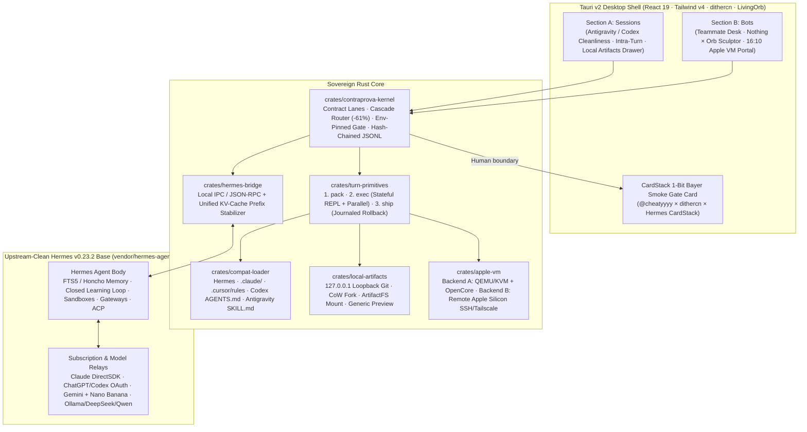

# Sovereign Rust Coding Harness Plan (v3) — Hermes v0.23.2 Base × Contraprova × Pure Nothing Monochrome

> [!IMPORTANT]
> **Architectural Stance — Sovereign Base, Upstream-Clean Hermes:** This is neither a Hermes plugin nor a hard fork. A **Rust core + Tauri v2 desktop shell** owns the governance kernel, 3-primitive execution plane, cross-harness compatibility loader, local Git artifacts server, Apple VM orchestrator, and two-section UI. Unmodified upstream **Hermes Agent (`v0.23.2` verified locally)** sits cleanly behind a versioned IPC bridge as the execution/memory/subscription engine so upstream Hermes updates (`git submodule update --remote`) land without merge conflicts.

---

## 1. Sovereign Rust Architecture (`Tauri v2` + Upstream-Clean Hermes)

Instead of modifying Hermes Python internals directly, the desktop application wraps an isolated `vendor/hermes-agent` runtime (launched via `uv` as a managed local sidecar) and routes every model call, memory lookup, and gateway action through **`crates/hermes-bridge`**.

### Why This Stays Update-Compatible with Hermes
- **Zero-Patch Sidecar Contract:** `vendor/hermes-agent` remains untouched upstream code. `crates/hermes-bridge` registers the 3 compound primitives (`pack`, `exec`, `ship`) as Hermes's sole active tool surface, sets `dontAsk` / custom tool-policy callbacks back to Rust's `contraprova-kernel`, and forwards memory/skill persistence events.
- **No Tool Bloat:** Hermes's 60+ built-in capabilities stay accessible *programmatically* inside `exec` and background Bot routines without injecting 60+ verbose JSON tool schemas into every LLM context window.

---

## 2. Zero-Redundancy Synthesis Matrix

Every borrowed research mechanism occupies **one exclusive layer** so nothing is duplicated:

| Component | Owned By | What Was Merged / Retired to Avoid Redundancy | Measured Benefit |
| :--- | :--- | :--- | :--- |
| **Governance Kernel, Escalation Cascade & Contract Lanes** | `crates/contraprova-kernel` | Unifies Contraprova's read-only orchestrator, frozen Contract Lanes, Tier-1 → Tier-2 → Tier-3 escalation (`Haiku/Local → Sonnet → Opus`), hash-chained JSONL ledger, and env-pinned `$HARNESS_GATE_CMD`. | **83/88 vs 85/88** SWE-bench Pro at **61% lower cost** (\$0.0546 vs \$0.1390/task); **36/37** parallel merges. |
| **Compound Tool 1: `pack`** | `crates/turn-primitives` | Replaces separate `grep`, `find`, `read_file`, `outline`, and `git_status` tools with Turnpack's byte-capped, secret-shielded multi-symbol context packer. | Collapses multi-turn context gathering into **1 round trip**. |
| **Compound Tool 2: `exec`** | `crates/turn-primitives` | **Merges `@RayaneRachid_` *Unharnessed* + `@TekonBurns` *Code Mode* + retires Turnpack `batch`.** One persistent stateful Python REPL where variables/ASTs survive across turns *and* Hermes/MCP/VM tools run concurrently via `await harness.parallel([...])`. | **71.2% SOTA** Terminal-Bench 4.0 + extends 5h/weekly subscription windows. |
| **Compound Tool 3: `ship`** | `crates/turn-primitives` → `contraprova-kernel` | **Merges Turnpack `ship` transport into Contraprova `gate.py`.** Workers propose edits; Turnpack validates fuzzy matches pre-write (`ABORTED_BEFORE_WRITE`), arms byte-exact disk rollback, and delegates verification solely to Kernel Gate (`scope:` + immutable tests + `$HARNESS_GATE_CMD`). | **46% faster**, **36% cheaper**, zero dirty trees on failed Tier-1 attempts. |
| **Intra-Turn Steering (`Feedforward` & `Leaving Blanks`)** | Frontend (`Sessions` & `Bots`) → Kernel | **Feedforward** previews inferred Tier/Scope/Tools before send; **Leaving Blanks** fires only on true architectural ambiguity inside a Contract Lane rather than on trivial edits. | Eliminates back-and-forth clarification turns. |
| **Unified Subscription & Cache Broker** | `crates/hermes-bridge` + Hermes `DirectSDK` | Normalizes Claude Code `stream-json` loopback relay (`ANTHROPIC_API_KEY` isolated), ChatGPT/Codex OAuth, Gemini + **Nano Banana**, and Open/Chinese/Local models (**DeepSeek, Qwen3-Coder, GLM, Kimi, Ollama/vLLM**) behind `Message.cache_upto` (`>= 512` tok). | **97.99%** follow-up KV-cache hit rate; **\$0 API markup** on active plans. |

---

## 3. Universal Cross-Harness Compatibility & Local Artifacts

### A. Cross-Harness Plugin & Skill Loader (`crates/compat-loader`)
A project opened in this harness works natively with existing setups from any ecosystem without manual rewriting:
- **Hermes Ecosystem:** Native `agentskills.io` skills, Hermes plugins, `MEMORY.md` / `USER.md`, and `hermes gateway` channel adapters.
- **Claude Code Ecosystem:** `.claude/skills/*/SKILL.md`, `.claude/commands/*.md`, `.claude/agents/*.md`, `.claude/hooks.json` (`PreToolUse`/`PostToolUse` mapped into Kernel Gate hooks), `.mcp.json`, and `CLAUDE.md`.
- **Cursor, Codex & Antigravity:** `.cursor/rules/*.mdc` (glob-triggered rules mapped to `scope:` briefs), `AGENTS.md`, and Antigravity `SKILL.md` + generic Artifact rendering.

### B. Git-Backed Local Artifacts (`crates/local-artifacts` — Inspired by `@dinasaur_404`)
Every generated file, UI widget, architectural diagram, report, or simulator build is stored as an isolated, versioned Git repository rather than loose temp files:
- **Loopback Git HTTP Server:** Embedded Rust `hyper`/`axum` endpoint at `http://127.0.0.1:<port>/git/<namespace>/<artifact>.git` supporting standard `git log`, `git diff`, and token-scoped pushes—persisted locally under the app's state store.
- **Instant Copy-on-Write Forking:** One-click `Fork (CoW)` snapshots any artifact revision (`v1`, `v2`, `v3`) into a counterfactual branch or a fresh Bot task without duplicating blobs.
- **Blobless Virtual Tree (`ArtifactFS`-style):** Browses commits/trees instantly via blobless fetches with on-demand blob hydration.
- **Generic Multi-Format Renderer:** Opens HTML/Tailwind/Canvas interactive previews (CSP-sandboxed WebView), Markdown + KaTeX + Mermaid diagrams, SVG/PNG/Nano Banana assets, code diffs, and iOS build outputs inside one collapsible right-hand drawer.

---

## 4. Built-In macOS & "Apple Bubble" VM Subsystem (`crates/apple-vm`)

Designed for Linux and Windows developers who want their agent to compile native Swift/Xcode projects and test iOS apps directly from the harness:

1. **Backend A — Local QEMU/KVM + OpenCore Runner (`Linux /dev/kvm` & `Windows WSL2 Nested KVM`):**
   - Orchestrates pre-configured QEMU/KVM + OpenCore images (wrapping `Docker-OSX` / `OSX-KVM` profiles) with **VirtioFS** workspace sharing so the agent edits Swift/Obj-C files on the host and triggers `xcodebuild` / `swift test` inside macOS over loopback SSH (`-p 50922:10022`).
   - Streams the live macOS desktop or isolated iOS Simulator window via low-latency WebRTC/VNC directly into the Bots **16:10 Remote Computer Portal**.
   - **Explicit Technical & Legal Constraints:**
     - *Metal & iOS Simulator Graphics:* Without dedicated VFIO GPU passthrough (or experimental Vulkan-to-Metal translation layers), software-rendered QEMU display adapters run Xcode CLI builds reliably at near-native CPU speed, while heavy Metal-backed iOS Simulator UI animations run slower on non-Apple hardware.
     - *Hardware Licensing Boundary:* Apple's macOS EULA restricts macOS virtualization to Apple-branded hardware; Local QEMU/KVM is strictly an opt-in developer/research backend for local use, never a hosted commercial cloud offering.
2. **Backend B — Remote / LAN Apple Silicon Node (Zero-Friction Fallback):**
   - One-click SSH / Tailscale pairing to a personal Mac mini, MacBook, or cloud Apple Silicon runner (with Tart VM support). Gives full Metal-accelerated iOS Simulator fidelity inside the exact same **16:10 Bot Computer Portal** UI.

---

## 5. Pure Nothing Monochrome Design System & `LivingOrb` Engine

Built strictly around Hermes's `apps/desktop/DESIGN.md` *"Flat, not boxed"* contract, Nothing OS 5.0's neutral hardware restraint, `@cheatyyyy`'s 1-bit Bayer gate card, and `aphesist/orb`'s soft-body physics.

### Strict Achromatic `R === G === B` Tokens + Surgical Nothing Crimson
Zero blue/slate tinting anywhere—every gray satisfies `R === G === B`:

| Token | Carbon (Dark Default) | Paper (Light) | Usage |
| :--- | :--- | :--- | :--- |
| `--bg-app` | `#000000` | `#F7F7F5` | Main stage canvas |
| `--bg-rail` | `#080808` | `#EFEFED` | `256px` left rail & side drawers |
| `--bg-surface` | `#0E0E0E` | `#FFFFFF` | Elevated cards, composer, popovers |
| `--bg-elevated` | `#141414` | `#F2F2F0` | Active tiles, interactive rows |
| `--bg-selected` | `#1B1B1B` | `#E8E8E5` | Selected rows & pill focus |
| `--border-hairline` | `rgba(255,255,255,0.075)` | `rgba(0,0,0,0.075)` | All `1px` flat structural dividers |
| `--border-strong` | `rgba(255,255,255,0.18)` | `rgba(0,0,0,0.18)` | Active inputs & `CardStack` rim |
| `--ink-primary` | `#F2F2F2` / `#FFFFFF` | `#111111` | Prose & focal headings (`Geist`) |
| `--ink-secondary` | `#8C8C8C` | `#525252` | Descriptions, muted roles |
| `--ink-tertiary` | `#525252` | `#8C8C8C` | Timestamps & metadata |
| `--accent-crimson` | `#D71921` | `#D71921` | **Surgical only** (Nothing dot-matrix corner pixel, gate/VM `5px` dot, unresolved blank dashed underline, optional 8th Orb finish) |

### Two Distinct Section Experiences (`[ Sessions | Bots ]`)
- **Section A — `Sessions` (Antigravity / Codex Cleanliness):** Flat `256px` session rail → airy `48px` header (`Title` + quiet `Cascade · -61%` & `Artifacts · v3` toggles) → spacious `660px` stream with 1-line `pack()` folds, `@liu_xingyu` **Leaving Blanks**, **`CardStack` 1-Bit Bayer Smoke Gate Card**, right-hand **Local Artifacts** Git drawer, and an `18px`-rounded **Feedforward** composer.
- **Section B — `Bots` (Bespoke Living Teammate Desk + Nothing × Orb Sculptor Studio):**
  - **Left Rail:** Nothing 3×3 dot-matrix mark + `[ Sessions | Bots ]` pill → **Living Crew Dock** (4 live `LivingOrb` companions in a flat grid + `+ Sculpt` button) → `1px` hairline → flat Bot threads.
  - **View B1 — Active Teammate Desk (Default):** Opens into an active companion (`iOS & Mac Runner`) with an interactive `76px` Hero `LivingOrb` presence header (reacts to typing in the composer with `thinking` downward squint, hops `happy` on send), corner-anchored bubbles, **`Hermes CardStack` × `@cheatyyyy` 1-Bit Smoke Approvals** (with a `96%`-scale queued second card peeking `6px` above that smoothly promotes on decision), a floating capsule composer, and a toggleable **`16:10` Apple Bubble VM** frame.
  - **View B2 — Nothing × Orb Sculptor Studio:** `120px` Hero `LivingOrb` over a radial `1px` dot-matrix grid with a live **Reaction Tester bar** (`Idle`, `Working`, `Thinking`, `Sleeping`, `Happy`, `Poke`), 8 Material Finishes (7 pure neutral tones + `#D71921`), **5 Eye Archetypes** (`capsule`, `slit`, `round`, `crescent`, `matrix`), Jelly Softness slider, and Blueprint presets.

### Cohesive `LivingOrb` Physics Engine (`aphesist/orb`)
- **Unified Soft-Body Sphere (`N_BODY = 96`):** All companions share one continuous soft-body circular geometry with `2.2×` oversized anti-clip canvases, real **floor-plane squash & contact shadow**, and 6-DOF Fourier wobble ($k \in \{2, 3, 4\}$).
- **Vertex-by-Vertex Smoothstep Morphing (`340ms`):** 32-point spherical eye contours smoothly interpolate between `idle`, `working`, `thinking`, `happy`, `sleeping`, `needs`, `surprised`, and `dizzy`—zero instant snapping.
- **Spherical Exponential-Map 3D Projection:** Eyes project onto the curved unit sphere rotated by damped-spring `(yaw, pitch, roll)` (`K = 95, D = 11`) with natural `4.1s` blinks (20% double-blink), autonomous `sleeping` (`z` particles + hover `wake` startle), drag-to-turn, and 3-stage escalating poke (`surprised` → `giggle ^ ^` → `dizzy`).

---

## 6. Multi-Agent Production Plan & `aphesist` Git Governance

### Parallel 5-Agent Build Swarm (Isolated Git Worktrees)
Once local prerequisites are confirmed, production runs across 5 specialized agents coordinated on isolated git worktrees so crates compile cleanly in parallel without file collisions:

| Agent | Worktree Scope | Ownership |
| :--- | :--- | :--- |
| **`@kernel-agent`** | `crates/contraprova-kernel/`, `crates/turn-primitives/` | Hash-chained JSONL ledger, Contract Lanes, Cascade Router (-61%), `pack`, stateful/parallel `exec`, and journaled `ship` |
| **`@bridge-compat-agent`** | `crates/hermes-bridge/`, `crates/compat-loader/` | IPC/JSON-RPC sidecar to `vendor/hermes-agent`, unified `cache_upto` stabilizer, DirectSDK/OAuth adapters, `.claude/` + Hermes + Cursor/Codex loader |
| **`@artifacts-vm-agent`** | `crates/local-artifacts/`, `crates/apple-vm/` | `127.0.0.1` loopback Git HTTP server, CoW `fork()`, `ArtifactFS` tree reader, QEMU/KVM+OpenCore & Remote Mac SSH/Tailscale + WebRTC stream |
| **`@ui-shell-agent`** | `src-tauri/`, `ui/` | Tauri v2 host, `LivingOrb` 60fps engine, `dithercn` `CardStack` approvals, `Sessions` (with Local Artifacts drawer), `Bots` (Teammate Desk + Sculptor + `16:10` VM portal) |
| **`@verifier`** | Read-only across all crates | Runs `cargo test`, `cargo clippy`, `pnpm test`, end-to-end gate invariants, and verifies zero co-author metadata before merges |

### Mechanical `aphesist` Commit Governance (Zero Co-Authoring)
Every repository initialized for this project configures local git identity and hooks mechanically so **every commit is authored strictly as `aphesist` with zero co-authoring**:
- `.git/config`: `user.name = aphesist` and `user.email = <your-aphesist-email>`
- `.git/hooks/commit-msg`: Strips or blocks any `Co-authored-by:`, `Signed-off-by:`, or agent attribution trailer before any commit is accepted.
